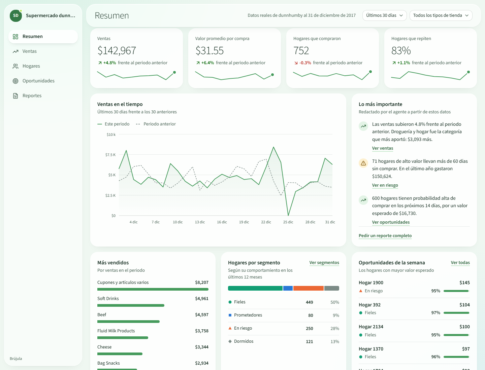
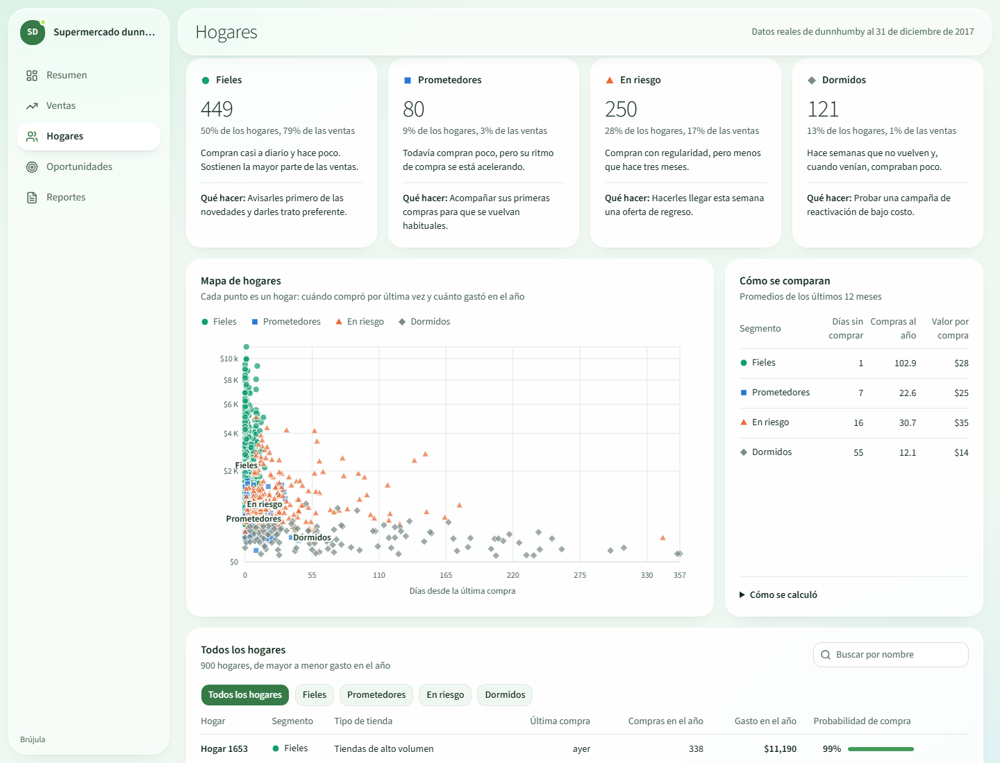
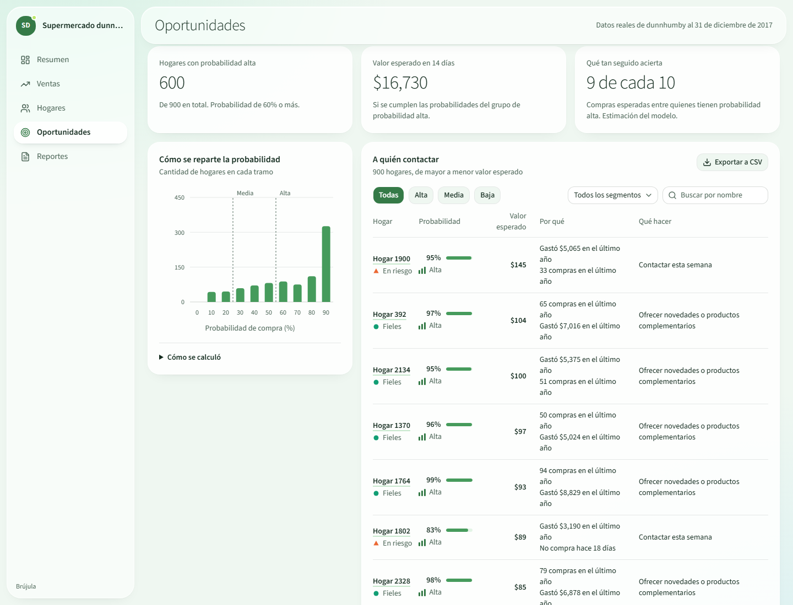

# Brújula: segmentación de clientes y propensión de compra para PYMEs

Demo de un SaaS de analítica para PYMEs. Responde dos preguntas: **qué tipos de clientes tiene el negocio** y **quién va a volver a comprar pronto**. Funciona con dos fuentes de datos:

- **Datos reales:** un año de compras de un supermercado (dunnhumby *The Complete Journey*). Los segmentos salen de **K-Means + SVM** y la propensión de compra de **LightGBM**, entrenados y evaluados en [`ml/`](ml/). Es lo que se ve al abrir la app.
- **Datos simulados:** presets de empresas ficticias para mostrarle a cada cliente cómo se vería el producto con su nombre, su color y su vocabulario. Se eligen en el panel de demo (Ctrl + punto) o con `?empresa=tienda-demo`.



## Modelos con datos reales

| Pregunta | Modelo | Resultado en datos no vistos |
|---|---|---|
| ¿Qué tipos de clientes tengo? | K-Means (k = 4) descubre los segmentos; un SVM RBF los asigna con datos nuevos | F1 macro del SVM: **0,98** (lineal: 0,94) |
| ¿Quién comprará en los próximos 14 días? | LightGBM + Optuna + calibración de Platt, con explicaciones SHAP | ROC-AUC **0,867** · Brier 0,133 (logística base: 0,863 · 0,136) |

- Validación **temporal**: se entrena con el pasado y se mide en semanas posteriores, como funcionaría en producción. Un test comprueba que ninguna feature mira el futuro.
- Las explicaciones SHAP se agrupan en los cinco factores que muestra la app y suman exactamente la probabilidad, así que el "por qué" que ve el usuario es fiel al modelo.
- La matriz de migración entre segmentos convierte el modelo en acciones. Por ejemplo: 126 clientes fieles empezaron a bajar el ritmo en el último trimestre.

Notebooks, decisiones, limitaciones y cómo reproducirlo: [`ml/README.md`](ml/README.md).

| Hogares por segmento | A quién contactar |
|---|---|
|  |  |

"Brújula" es un nombre provisional. Se cambia en `src/lib/producto.ts`.

## Cómo correrlo

Requiere Node 20.9 o superior.

```bash
npm install
npm run dev
```

Abre <http://localhost:3000>.

| Comando | Qué hace |
|---|---|
| `npm run dev` | Servidor de desarrollo |
| `npm run build` | Compilación de producción |
| `npm run start` | Sirve la compilación de producción |
| `npm test` | Pruebas (datos, presets, cargador de datos reales, contraste de la marca) |
| `npm run typecheck` | Revisión de tipos |
| `npm run lint` | Linter |

## Pantallas

| Ruta | Qué muestra |
|---|---|
| `/resumen` | Indicadores, ventas en el tiempo, hallazgos, más vendidos, segmentos y oportunidades |
| `/ventas` | Ventas por categoría, canal, zona y día de la semana; tabla exportable |
| `/clientes` | Segmentación: tarjetas por segmento, mapa de clientes y lista filtrable |
| `/oportunidades` | Propensión de compra: a quién contactar, por qué y qué hacer |
| `/reportes` | Agente que arma reportes listos para imprimir o guardar como PDF |
| `/sistema` | Galería interna del sistema visual (no aparece en la navegación) |

## Preparar la demo para una empresa

### En vivo, con el panel de demo

El panel está oculto. Se abre con **Ctrl + punto** o agregando `?demo=1` a la URL.

Desde ahí se cambia: empresa de partida, nombre, logo, rubro, moneda, color de marca, indicadores del resumen, vocabulario, nombres de los segmentos, luz del fondo, transparencia del marco y modo proyector. Los cambios se guardan en el navegador.

- **Exportar preset** descarga la configuración actual como JSON.
- **Importar preset** carga un JSON exportado antes.
- **Restablecer** vuelve al preset original.

### Dejarla guardada en el código

1. Copia `src/tenants/presets/tienda-demo.ts` (retail) o `distribuidora-demo.ts` (B2B) con otro nombre.
2. Cambia sus valores. Si exportaste un JSON desde el panel, puedes pegar su contenido como valor del preset.
3. Agrégalo a la lista `PRESETS` en `src/tenants/index.ts`.
4. Ábrelo con `?empresa=<id>`, por ejemplo `/resumen?empresa=tienda-demo`.

Las pruebas (`npm test`) validan que todos los presets cumplan el esquema.

### Para la reunión

- Usa `npm run build` y `npm run start`: la compilación de producción es más rápida que el modo desarrollo.
- Si vas a proyectar, activa el **modo proyector** en el panel.
- El agente de reportes funciona sin conexión: no llama a ningún servicio.

## Cómo está organizado

```
src/
  app/                 rutas y estilos globales (tokens en globals.css)
  components/
    shell/             marco: fondo, barra lateral, barra superior, panel de demo
    charts/            piezas de gráficas
    glass/             tarjeta de datos
    ui/                componentes base de shadcn/ui
  features/            una carpeta por pantalla
  tenants/             esquema de presets, valores por rubro y presets
  lib/
    data/              datos: tipos, consultas, propensión, reportes, repositorio
    data/mock/         generador de datos con semilla
    data/real/         cargador del JSON exportado por los modelos
    theme/             rampa de marca
  state/               preset activo y filtros (Zustand)
docs/design-system.md  sistema visual
ml/                    ciencia de datos: notebooks, paquete brujula_ml y tests (ver ml/README.md)
public/data/           datos reales exportados por ml/ (dunnhumby.json)
```

Tres límites mantienen el front reutilizable:

- **Preset** (`src/tenants/`). Todo lo propio de una empresa vive en su preset. Las pantallas no contienen textos ni cifras de una empresa concreta.
- **Repositorio de datos** (`src/lib/data/repository.ts`). Las pantallas solo piden datos ahí.
- **Tema** (`src/app/globals.css`). El tono de marca del preset alimenta las variables CSS.

## Qué es simulado y cómo pasar a lo real

| Parte | Presets simulados | Preset dunnhumby | Para producción |
|---|---|---|---|
| Datos | Generador determinista (`lib/data/mock/generador.ts`): misma semilla, mismos datos | Compras reales de 900 hogares, exportadas por `ml/` y cargadas por `lib/data/real/cargar.ts` | Cada función de `repository.ts` pasa a llamar a la API |
| Segmentación | Los clientes nacen de cuatro arquetipos | K-Means + SVM entrenados (`ml/notebooks/02`) | El SVM asigna segmentos en el backend cada vez que llegan datos |
| Propensión | Regresión logística con pesos fijos (`lib/data/propension.ts`) | LightGBM calibrado con factores SHAP (`ml/notebooks/03`) | El modelo se reentrena periódicamente y puntúa en el backend |
| Agente de reportes | Cuatro reportes armados con plantillas sobre los mismos datos del tablero; una pregunta escrita se dirige a uno de ellos por palabras clave | Igual | Llamada a un LLM desde el servidor |

Las cifras de los reportes salen de las mismas consultas que el tablero, así que siempre coinciden. Hay pruebas que lo comprueban.

## Sistema visual

Ver [`docs/design-system.md`](docs/design-system.md).
