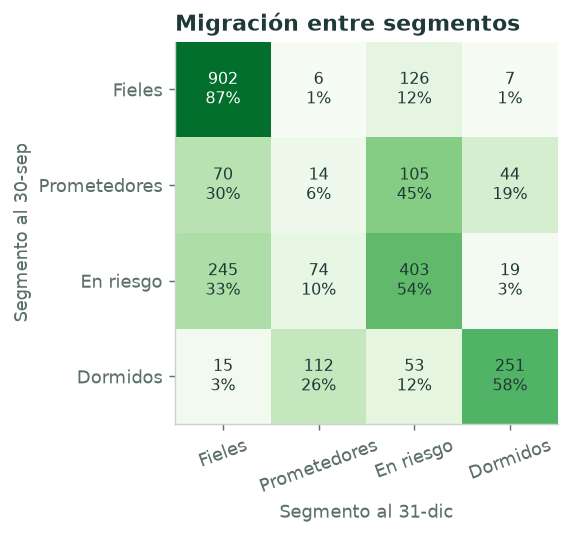
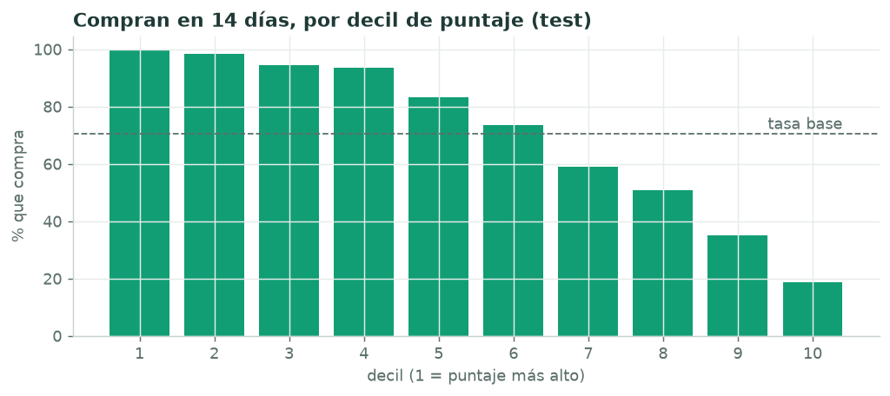
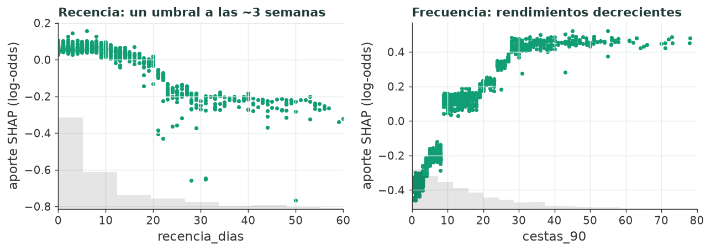

# Modelos de Brújula: segmentación y propensión de compra

Ciencia de datos detrás del dashboard. Se trabaja con datos reales de un supermercado, **dunnhumby *The Complete Journey***: 2.469 hogares, 155.000 compras y 1,47 millones de líneas de ticket de 2017. Los modelos responden las dos preguntas del producto:

1. **¿Qué tipos de clientes tengo?** K-Means descubre cuatro segmentos y un **SVM** asigna cada hogar a su segmento con datos nuevos.
2. **¿Quién va a volver a comprar pronto?** **LightGBM** estima la probabilidad de compra en los próximos 14 días y SHAP explica cada puntaje.

Los resultados se exportan a `public/data/dunnhumby.json` y la app los muestra en el preset **"Supermercado dunnhumby"**, que es el que abre la app por defecto.

## Notebooks

| Notebook | Qué hace |
|---|---|
| [`01_exploracion`](notebooks/01_exploracion.ipynb) | Calidad de los datos, comportamiento de compra y decisiones de diseño, como fijar la ventana de 14 días |
| [`02_segmentacion_svm`](notebooks/02_segmentacion_svm.ipynb) | Elección de k, perfiles de segmento, SVM RBF y migración entre segmentos |
| [`03_propension_boosting`](notebooks/03_propension_boosting.ipynb) | Validación temporal, línea base logística, LightGBM + Optuna, calibración, lift y SHAP |
| [`04_exportar_dashboard`](notebooks/04_exportar_dashboard.ipynb) | Exportación al formato del dashboard con comprobaciones |

Cada notebook tiene su par `.py` (formato *percent* de jupytext) para revisar cambios con `git diff`. La lógica vive en el paquete [`src/brujula_ml`](src/brujula_ml), que tiene tests; los notebooks quedan para la narrativa y las figuras.

## Resultados

### Segmentación (corte de entrenamiento: 30-sep-2017)

| | |
|---|---|
| Segmentos | 4: Fieles, Prometedores, En riesgo, Dormidos |
| Estabilidad (ARI medio entre réplicas bootstrap) | 0,86 |
| SVM RBF · F1 macro en test | **0,980** (SVM lineal: 0,935) |
| Hogares que mantienen su segmento de septiembre a diciembre | 64 % |



Los *Prometedores* son el segmento más volátil: en tres meses, el 30 % se vuelve *Fiel* y el 45 % se enfría y pasa a *En riesgo*. Además, 126 *Fieles* empezaron a bajar el ritmo. Esa lista es la que conviene atender primero en una campaña de retención.

### Propensión de compra (test: corte del 1-dic-2017)

| Modelo | ROC-AUC | PR-AUC | Brier | Log-loss |
|---|---|---|---|---|
| Regresión logística (línea base) | 0,863 | 0,941 | 0,136 | 0,414 |
| **LightGBM + calibración de Platt** | **0,867** | **0,941** | **0,133** | **0,406** |

Tasa base: 71 % de los hogares compra en 14 días. Diferencia de AUC: +0,004, IC 95 % bootstrap [−0,0001; +0,0069].



**Lectura honesta.** LightGBM mejora en todas las métricas de ordenamiento y calibración, pero poco. En la compra de supermercado manda el hábito: una vez que el modelo sabe cuándo compró el hogar por última vez y con qué frecuencia viene, queda poca señal por exprimir, y una logística bien hecha ya captura casi toda. Se eligió LightGBM por tres razones: está mejor calibrado, capta no linealidades sin trabajo manual (por ejemplo, el umbral de recencia a las ~3 semanas) y da explicaciones exactas por cliente con TreeSHAP.



Todas las métricas están en [`reports/metricas.json`](reports/metricas.json).

## Decisiones de diseño

- **Validación temporal, no aleatoria.** Cada snapshot calcula las features con lo ocurrido hasta la fecha de corte *t* y la etiqueta con (*t*, *t*+14]. Se entrena con 8 cortes (marzo–octubre), se ajusta en el 15-nov y se mide una sola vez en el 1-dic. Un test comprueba que las features no miran el futuro.
- **Ventana de 14 días.** A 30 días vuelve el 83–86 % de los hogares, demasiado para que el modelo discrimine. A 14 días la tasa base baja a ~71 % ([notebook 01](notebooks/01_exploracion.ipynb), sección 6).
- **Clustering y después SVM.** K-Means define los segmentos una vez. Volver a clusterizar cada mes movería las fronteras y cambiaría el significado de los grupos. El SVM fija esas definiciones, asigna en milisegundos y da una confianza por hogar. Los nombres de negocio se asignan con el algoritmo húngaro contra arquetipos, así que es reproducible y no depende de mirar a ojo.
- **Calibración de Platt.** Es afín en log-odds, así que conserva la suma de los aportes SHAP: lo que la app muestra como "por qué" (recencia, frecuencia, valor, promociones, tendencia) suma exactamente la probabilidad. La isotónica rompería esa propiedad.
- **Demografía solo descriptiva.** Solo el 32 % de los hogares la tiene, y una PYME rara vez cuenta con esos datos.

## Adaptaciones al formato del dashboard

dunnhumby no es una PYME, así que algunas dimensiones de la app se derivan:

| En la app | Viene de |
|---|---|
| Cliente / pedido | hogar / cesta |
| Producto | subcategoría (`product_category`, nombres originales en inglés); su categoría es el departamento, traducido |
| Zona | volumen de la tienda: las 457 tiendas agrupadas en tercios de la venta. Las 6 mayores solo suman el 13 % |
| Canal | si la cesta llevó descuento ("Con promoción" / "Precio regular") |
| Promociones usadas | de las últimas 5 campañas recibidas, en cuántas canjeó un cupón |

Se exporta una muestra de 900 hogares estratificada por segmento, con todo su historial, para que el JSON pese menos de 5 MB (1,4 MB comprimido).

## Cómo reproducirlo

Requiere Python 3.11 o superior. Desde la carpeta `ml/`:

```bash
python -m venv .venv
.venv/Scripts/activate            # Windows · en macOS/Linux: source .venv/bin/activate
pip install -r requirements.txt
pip install -e .

python -m brujula_ml.datos        # descarga (~40 MB), verifica SHA-256 y convierte a parquet

# ejecuta los notebooks en orden (02 → 03 → 04 dependen del anterior)
jupyter nbconvert --to notebook --execute --inplace notebooks/0*.ipynb

pytest                            # tests sobre datos sintéticos + coherencia del JSON exportado
```

Los datos crudos (`data/`) y los modelos entrenados (`models/`) no se versionan. Las huellas SHA-256 de cada archivo descargado sí: están en [`datos.sha256.json`](datos.sha256.json). Todos los procesos usan semilla fija, así que dos ejecuciones dan los mismos resultados.

## Limitaciones

- Un solo año de datos: no hay estacionalidad interanual y el periodo "12 meses" del dashboard no tiene contra qué compararse.
- Los primeros meses están censurados por la izquierda: la mayoría de los hogares "aparece" en enero porque ahí empiezan los datos.
- Canal y zona son derivados; no son campos del dataset original.
- El techo de la propensión parece estar cerca de AUC 0,87 con estas señales. Para subirlo harían falta datos externos a las compras, como visitas web o respuesta a campañas en tiempo real.

## Datos y licencia

*The Complete Journey* es un dataset publicado por [dunnhumby](https://www.dunnhumby.com/source-files/). Se usa la versión del paquete R [`completejourney`](https://github.com/bradleyboehmke/completejourney) (repositorio de Bradley Boehmke), publicada con licencia **CC0**.
